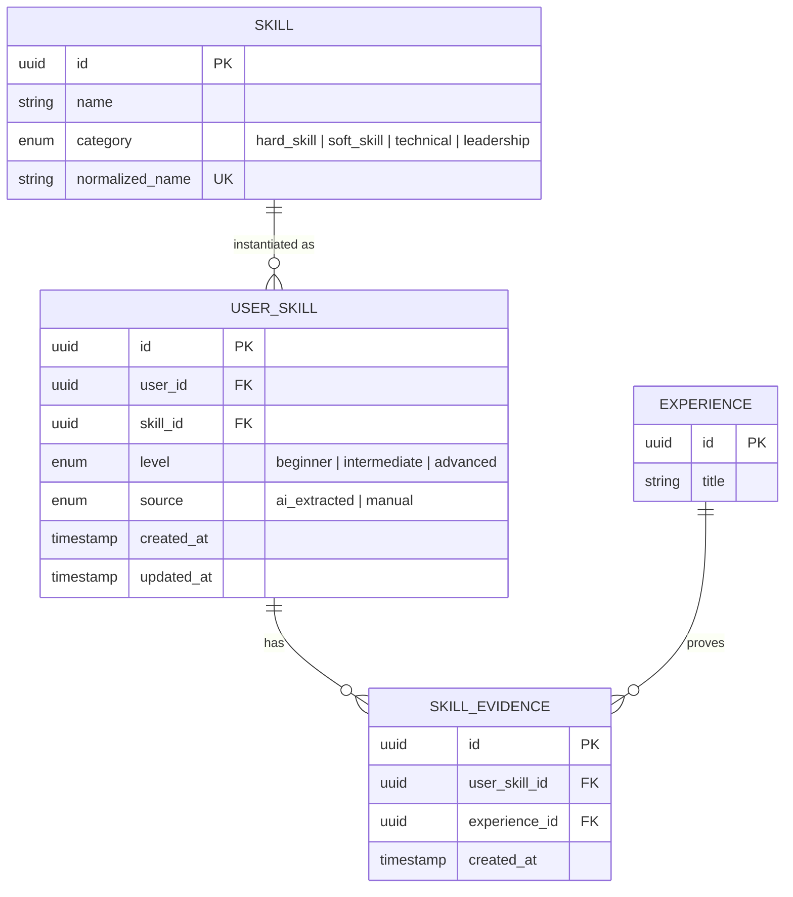

# 📊 Feature: F05 — Skill Profile & Pattern Map

> **Branch:** `feature/f05-skill-profile`  
> **PIC / Assignee:** Anggota B (Beban: 40% — *Intelligence & Career Engine*)  
> **Prioritas:** P0 (Must Have)  
> **Dependency:** F04 (AI Skill Extraction) harus sudah di-merge (`USER_SKILL` & `SKILL_EVIDENCE` tersedia)  
> **Target Merge:** `develop` (Merge ke-5)  
> **Dokumen Terkait:** [PRD (F05)](./plan-md/prd.md#f05--skill-profile) · [Task Management](./plan-md/task-management.md#f05--skill-profile) · [ERD](./plan-md/erd_growvia.md)

---

## 📌 Deskripsi Fitur

Skill Profile adalah ruang visualisasi komprehensif bagi mahasiswa untuk melihat, mengeksplorasi, dan mengelola inventaris keahlian (*skill inventory*) yang mereka miliki. Dilengkapi dengan **Skill Pattern Map** (graf interaktif node/edge) yang memperlihatkan bagaimana satu keahlian terhubung dengan keahlian lain melalui jejak pengalaman nyata.

---

## 🎯 Spesifikasi Kebutuhan & Sub-Fitur (PRD)

### F05.1 Skill Overview (Statistik & Distribusi)
- Menampilkan metrik utama:
  - **Total Keahlian** yang dimiliki user.
  - **Distribusi Kategori**: Grafik persentase keahlian dalam 4 ranah (`Hard Skill`, `Soft Skill`, `Technical`, `Leadership`).
  - **Top 5 Skills**: Lima skill terkuat berdasarkan jumlah bukti pengalaman (*evidence count*) terbanyak.

### F05.2 Skill Pattern Map (Visualisasi Graf Interaktif)
- Peta visual berbasis graf keterhubungan (*knowledge graph*):
  - **Node**: Merepresentasikan satu skill spesifik. Ukuran node proporsional dengan jumlah evidence atau level penguasaan.
  - **Warna Node**: Dikodekan berdasarkan kategori (*color-coding*: Hijau untuk Technical, Ungu untuk Leadership, Biru untuk Hard Skill, Oranye untuk Soft Skill).
  - **Edge (Garis Penghubung)**: Terbentuk otomatis antara dua skill yang sering muncul bersamaan (*co-occurrence*) dalam satu pengalaman yang sama.
  - Interaktivitas: Zoom in/out, drag node, klik node untuk membuka panel rincian skill.
  - Implementasi pustaka: D3.js, Vis.js, atau React Flow.

### F05.3 Skill Detail & Bukti Portofolio (Evidence Link)
- Panel detail saat sebuah skill diklik:
  - Nama skill, kategori, tingkat kemahiran (`Beginner` | `Intermediate` | `Advanced`).
  - **Daftar Bukti Nyata (*Evidence List*)**: Menampilkan card pengalaman mana saja yang mendasari skill ini. Kartu pengalaman dapat diklik untuk membuka modal rincian aktivitas aslinya.
  - Aksi Pengguna:
    - Ubah tingkat kemahiran (level) secara manual.
    - Hapus skill dari profil (dengan dialog konfirmasi).

### F05.4 Tambah Skill Mandiri (Manual Add Skill)
- Formulir penambahan keahlian tanpa melalui ekstraksi narasi AI:
  - Input: Nama Skill, Kategori, Tingkat Level, dan Bukti Opsional (pilih dari pengalaman yang ada).
  - Skill yang ditambahkan manual diberi label `source = 'manual'` dan tidak memiliki AI Badge.

---

## 🗄️ Lingkup Backend & Skema Basis Data

### Endpoint API

| Method | Endpoint | Deskripsi | Proteksi Auth |
|---|---|---|---|
| `GET` | `/api/skills/profile` | Mengambil seluruh daftar skill user beserta bukti evidence & metrik | User Auth |
| `GET` | `/api/skills/:id` | Detail spesifik suatu skill dan riwayat bukti pengalaman | User Auth |
| `POST` | `/api/skills` | Menambahkan skill baru secara manual | User Auth |
| `PUT` | `/api/skills/:id` | Memperbarui tingkat kemahiran (level) skill | User Auth |
| `DELETE` | `/api/skills/:id` | Menghapus skill dari profil user | User Auth |
| `GET` | `/api/skills/graph` | Format data nodes & edges untuk visualisasi Skill Pattern Map | User Auth |

### Entitas Basis Data (Ownership: Anggota B untuk Read & Management)



---

## 💻 Lingkup Frontend

### Rute Halaman
- `src/app/(dashboard)/skills/page.tsx` ➔ Halaman utama profil skill & pattern map.

### Komponen UI
- `SkillStatsOverview.tsx` ➔ Kartu metrik total skill, distribusi kategori, dan Top 5.
- `SkillPatternMap.tsx` ➔ Kanvas visualisasi graf D3/vis.js responsif.
- `SkillCard.tsx` ➔ Kartu skill individual dengan indikator level, jumlah evidence, dan badge AI/Manual.
- `SkillDetailDrawer.tsx` ➔ Drawer/modal rincian riwayat bukti pengalaman.
- `ManualAddSkillModal.tsx` ➔ Modal form tambah skill mandiri.

---

## ✅ Kriteria Penerimaan (Acceptance Criteria)

- [ ] Menampilkan seluruh skill user secara akurat lengkap dengan daftar pengalaman pembuktiannya.
- [ ] Visualisasi graf interaktif berfungsi responsif (dapat di-zoom, digeser, dan diklik).
- [ ] Pengguna dapat mengedit level kemahiran atau menghapus skill secara aman.
- [ ] Bukti pengalaman yang terhubung dapat diklik untuk meninjau rincian pengalaman aslinya.
- [ ] Penambahan skill manual tersimpan dengan penanda `source = 'manual'`.

---

## 🛠️ Panduan Pengembangan

```bash
# 1. Jalankan development server
npm run dev

# 2. Buka halaman skill profile:
# http://localhost:3000/skills

# 3. Jalankan pengujian linting
npm run lint
```
