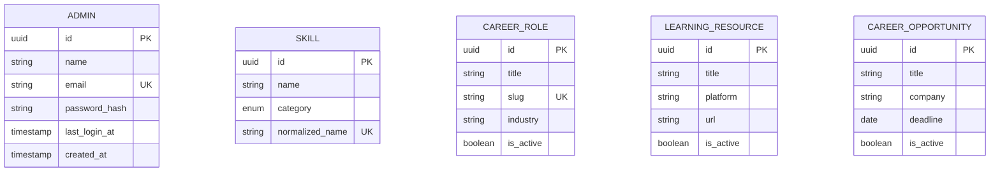

# 🛡️ Feature: F13 — Admin Dashboard & Master Data Management

> **Branch:** `feature/f13-admin`  
> **PIC / Assignee:** Anggota B (Beban: 40% — *Intelligence & Career Engine*)  
> **Prioritas:** P1 (Should Have — *Katalis Master Data Ekosistem*)  
> **Dependency:** F01 (Auth), F05 (Skill Profile), dan F06 (Career Gap) sudah di-merge  
> **Target Merge:** `develop` (Merge ke-12)  
> **Dokumen Terkait:** [PRD (F13)](./plan-md/prd.md#f13--admin-dashboard) · [Task Management](./plan-md/task-management.md#f13--admin-dashboard) · [ERD](./plan-md/erd_growvia.md)

---

## 📌 Deskripsi Fitur

Admin Dashboard adalah antarmuka internal terpisah bagi tim pengelola Growvia untuk mengurasi dan memelihara seluruh **Master Data** (Taksonomi Keahlian, Peran Karier, Standar Kebutuhan Keahlian Industri, Sumber Belajar, dan Peluang Magang/Kerja). Master data ini merupakan fondasi wajib agar algoritma rekomendasi pembelajaran (F07) dan kecocokan peluang karier (F08) dapat beroperasi secara presisi.

> ⚠️ **Scope Admin MVP:** Dirancang khusus untuk pengelolaan data master. Akses autentikasi terisolasi dari aplikasi umum pengguna dan tidak mencakup modul analitik rumit atau CMS publik.

---

## 🎯 Spesifikasi Kebutuhan & Modul Admin (PRD)

```text
                               ┌───────────────────────────┐
                               │     F13.1 Admin Login     │
                               └─────────────┬─────────────┘
                                             │ (Session 8 Jam)
                                             ▼
                               ┌───────────────────────────┐
                               │   F13.2 Admin Overview    │
                               │  (Statistik 4 Master Data)│
                               └─────────────┬─────────────┘
                                             │
      ┌───────────────────┬──────────────────┴────────────────┬───────────────────┐
      ▼                   ▼                                   ▼                   ▼
[ F13.3 Manage      [ F13.4 & F13.5                     [ F13.6 Manage      [ F13.7 Manage
    Skills ]         Career Paths & Required Skills ]      Resources ]         Opportunities ]
```

### F13.1 Admin Authentication & Session
- Form login khusus di rute `/admin/login` (email + password).
- Tidak ada opsi registrasi mandiri publik (akun admin didaftarkan internal/seed).
- Token sesi admin terpisah secara independen dari sesi pengguna biasa.
- Masa aktif sesi: **8 jam inaktif**.
- Dilindungi oleh middleware keamanan khusus `adminAuthMiddleware`.

### F13.2 Admin Overview Dashboard
- Ringkasan kartu statistik metrik real-time:
  - **Total Skills** terdaftar.
  - **Total Career Paths** aktif.
  - **Total Learning Resources** aktif.
  - **Total Career Opportunities** aktif.

### F13.3 Pengelolaan Taksonomi Skill (Manage Skills)
- Tabel data skill: Nama, Kategori (`hard_skill` | `soft_skill` | `technical` | `leadership`), Normalized Name, Tanggal Dibuat.
- Pencarian dan filter kategori.
- Operasi CRUD: Tambah, edit, dan **Safe Delete** (sistem menolak penghapusan skill jika skill tersebut sedang digunakan oleh profil user, target karier, atau materi belajar).
- Auto-generate `normalized_name` (huruf kecil tanpa spasi) saat mengetik nama skill.

### F13.4 Pengelolaan Peran Karier (Manage Career Paths)
- Tabel peran karier: Nama Posisi, Industri, Jumlah Required Skills terikat, Status Aktif.
- CRUD Peran Karier: Nama peran, Slug URL, Deskripsi, Industri.
- Fitur penonaktifan (*Soft Delete*): Peran yang sudah dipilih oleh mahasiswa tidak dihapus permanen, melainkan dinonaktifkan (`is_active = false`).

### F13.5 Pengelolaan Kebutuhan Keahlian Karier (Manage Required Skills)
- Mengatur relasi antara peran karier dengan daftar keahlian yang disyaratkan.
- Menentukan tingkat kepentingan (*Importance*): `must_have` | `important` | `nice_to_have`.
- Menentukan standar minimum kemahiran (*Min Level*): `beginner` | `intermediate` | `advanced`.
- *Trigger Otomatis*: Perubahan required skill memicu pembaruan analisis gap pada sesi user berikutnya.

### F13.6 Pengelolaan Sumber Belajar (Manage Learning Resources)
- CRUD materi belajar kandidat rekomendasi:
  - Judul, Platform (Coursera, Dicoding, YouTube, dsb), URL Sumber, Tipe, Durasi, Tingkat Kesulitan, Rating.
  - Multi-select Tagging Keahlian (minimal terhubung ke 1 skill dari master `SKILL`).
  - Saklar status aktif (materi nonaktif otomatis dikeluarkan dari pool rekomendasi pengguna).

### F13.7 Pengelolaan Lowongan Karier (Manage Opportunities)
- CRUD lowongan magang dan kerja:
  - Judul Pekerjaan, Nama Perusahaan, Lokasi, Model Kerja (Remote/Onsite), URL Pendaftaran, Tanggal Deadline, Tag Keahlian.
  - Penandaan kedaluwarsa otomatis jika tanggal melewati deadline (`is_active = false`).

---

## 🗄️ Lingkup Backend & Skema Basis Data

### Endpoint API

| Method | Endpoint | Deskripsi | Proteksi Auth |
|---|---|---|---|
| `POST` | `/api/admin/auth/login` | Login admin & issue admin JWT session | Publik |
| `POST` | `/api/admin/auth/logout` | Mengakhiri sesi login admin | Admin Auth |
| `GET` | `/api/admin/overview` | Mengambil data metrik ringkasan master data | Admin Auth |
| `GET/POST/PUT/DELETE` | `/api/admin/skills` | Operasi CRUD master taksonomi skill | Admin Auth |
| `GET/POST/PUT/DELETE` | `/api/admin/career-roles` | Operasi CRUD master peran karier | Admin Auth |
| `GET/POST/PUT/DELETE` | `/api/admin/career-roles/:id/skills` | Operasi mapping skill wajib per peran karier | Admin Auth |
| `GET/POST/PUT/DELETE` | `/api/admin/learning-resources` | Operasi CRUD materi pembelajaran & tags | Admin Auth |
| `GET/POST/PUT/DELETE` | `/api/admin/opportunities` | Operasi CRUD lowongan karier & tags | Admin Auth |

### Middleware Khusus (`adminAuthMiddleware`)
- Memvalidasi token sesi admin dan memastikan klaim otorisasi `role = 'admin'`.
- Mengembalikan `403 Forbidden` jika pengguna umum mencoba mengakses endpoint admin.

### Entitas Basis Data (Ownership: Anggota B)



---

## 💻 Lingkup Frontend

### Rute Halaman Terisolasi
- `src/app/(admin)/admin/login/page.tsx` ➔ Halaman masuk khusus admin.
- `src/app/(admin)/admin/dashboard/page.tsx` ➔ Ringkasan statistik master data.
- `src/app/(admin)/admin/skills/page.tsx` ➔ Pengelolaan taksonomi skill.
- `src/app/(admin)/admin/career-roles/page.tsx` ➔ Pengelolaan peran karier & required skills.
- `src/app/(admin)/admin/learning-resources/page.tsx` ➔ Pengelolaan sumber materi belajar.
- `src/app/(admin)/admin/opportunities/page.tsx` ➔ Pengelolaan peluang lowongan karier.

### Komponen UI
- `AdminLayout.tsx` ➔ Template tata letak terpisah khusus dashboard admin (sidebar navigasi admin).
- `AdminDataTable.tsx` ➔ Komponen tabel dinamis terstandarisasi dengan pagination, search, dan tombol aksi.
- `AdminCRUDModal.tsx` ➔ Dialog formulir tambah/edit generik responsif.
- `AdminStatCard.tsx` ➔ Kartu ringkasan metrik statistik.

---

## ✅ Kriteria Penerimaan (Acceptance Criteria)

- [ ] Seluruh rute `/admin/*` terlindungi ketat dari akses pengguna publik/biasa.
- [ ] CRUD untuk seluruh 5 kategori master data berfungsi dengan validasi input yang solid.
- [ ] Safe-delete mencegah penghapusan skill yang masih memiliki ketergantungan relasi data.
- [ ] Perubahan pada required skill karier secara otomatis terintegrasi ke kalkulasi gap di F06.
- [ ] Sesi admin kadaluarsa otomatis setelah 8 jam tidak aktif.

---

## 🛠️ Panduan Pengembangan

```bash
# 1. Jalankan development server
npm run dev

# 2. Buka portal login admin:
# http://localhost:3000/admin/login
# http://localhost:3000/admin/dashboard

# 3. Lakukan audit kode
npm run lint
```
