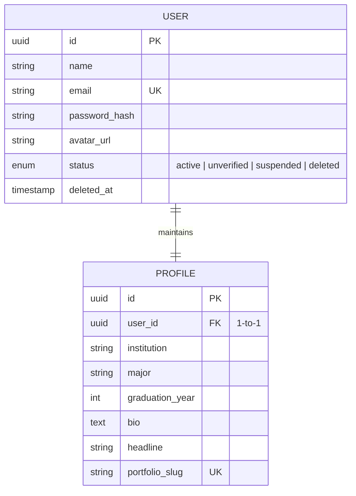

# ⚙️ Feature: F12 — Profile & Account Settings

> **Branch:** `feature/f12-profile-settings`  
> **PIC / Assignee:** Anggota C (Beban: 20% — *Discovery & Identity*)  
> **Prioritas:** P0 (Must Have)  
> **Dependency:** F01 (Authentication) selesai (dapat dikerjakan secara independen)  
> **Target Merge:** `develop` (Merge Paralel)  
> **Dokumen Terkait:** [PRD (F12)](./plan-md/prd.md#f12--profile--settings) · [Task Management](./plan-md/task-management.md#f12--profile--settings) · [ERD](./plan-md/erd_growvia.md)

---

## 📌 Deskripsi Fitur

Fitur Profile & Settings memfasilitasi pengguna untuk mengelola identitas pribadi, foto profil, preferensi akun, keamanan kredensial, kontrol privasi publik, hingga penghapusan akun secara aman (*Soft Delete*). Fitur ini berdiri secara independen dan dapat mulai dikembangkan segera setelah modul autentikasi dasar (F01) tersedia.

---

## 🎯 Spesifikasi Kebutuhan & Sub-Fitur (PRD)

### F12.1 Pengelolaan Profil (Edit Profile)
- Pengguna dapat memperbarui informasi diri:
  - **Nama Lengkap**
  - **Institusi Pendidikan & Jurusan**
  - **Tahun Kelulusan / Angkatan**
  - **Headline Profesional** (contoh: *"Informatics Student \| Aspiring AI Engineer"*).
  - **Biografi Singkat** (ringkasan ketertarikan karier).
- **Unggah Foto Avatar**:
  - Dukungan format: JPEG, PNG, WebP (maksimal 2MB).
  - Integrasi penyimpanan awan (*Cloud Storage*: S3 / Supabase Storage / GCS).
  - Pratinjau gambar instan sebelum disimpan.

### F12.2 Keamanan Akun (Account Settings)
- **Ganti Password**:
  - Input: Password saat ini, Password baru, Konfirmasi password baru.
  - Validasi ketat sama seperti pendaftaran (min. 8 karakter, 1 huruf besar, 1 angka).
  - Pesan error informatif jika password lama salah.
- **Ubah Alamat Email**:
  - Input alamat email baru.
  - Sistem mengirimkan email konfirmasi ke alamat baru; status email berganti setelah link verifikasi di alamat baru diakses.

### F12.3 Pengaturan Privasi (Privacy Settings)
- **Visibilitas Portofolio Publik**:
  - *Toggle switch*: `Publik` (portofolio dapat dilihat via link `/u/:slug`) vs `Privat` (halaman publik dinonaktifkan sementara dan mengembalikan 404).

### F12.4 Penghapusan Akun (Delete Account / Danger Zone)
- Mekanisme **Soft Delete** demi keamanan data:
  - Pengguna harus melewati konfirmasi 2 langkah: mengetik kata konfirmasi (e.g. *"HAPUS AKUN SAYA"*) dan memasukkan password akun.
  - Status user diubah menjadi `deleted` dan kolom `deleted_at` diisi timestamp saat ini.
  - Data dipertahankan selama masa tenggang retensi 30 hari sebelum dihapus permanen.
  - Session user langsung dihanguskan dan diarahkan ke halaman login.

---

## 🗄️ Lingkup Backend & Skema Basis Data

### Endpoint API

| Method | Endpoint | Deskripsi | Proteksi Auth |
|---|---|---|---|
| `GET` | `/api/profile` | Mengambil data profil lengkap pengguna yang sedang login | User Auth |
| `PUT` | `/api/profile` | Memperbarui data profil (nama, bio, headline, institusi, jurusan) | User Auth |
| `POST` | `/api/profile/avatar` | Upload file gambar avatar ke Cloud Storage & simpan URL | User Auth |
| `PUT` | `/api/account/password` | Mengubah password akun dengan validasi password lama | User Auth |
| `PUT` | `/api/account/email` | Mengajukan perubahan email akun | User Auth |
| `PUT` | `/api/account/privacy` | Mengubah pengaturan privasi portofolio | User Auth |
| `DELETE` | `/api/account` | Melakukan soft delete terhadap akun pengguna | User Auth |

### Entitas Basis Data (Ownership: Anggota C & Anggota A)



---

## 💻 Lingkup Frontend

### Rute Halaman
- `src/app/(dashboard)/profile/page.tsx` ➔ Halaman tampilan & edit profil.
- `src/app/(dashboard)/settings/page.tsx` ➔ Halaman pengaturan akun, privasi, dan danger zone.

### Komponen UI
- `ProfileEditForm.tsx` ➔ Formulir data identitas diri dan pendidikan.
- `AvatarUploader.tsx` ➔ Komponen upload foto dengan drag & drop dan pratinjau.
- `SecuritySettings.tsx` ➔ Form ubah password dan email.
- `PrivacySettings.tsx` ➔ Saklar pengaturan visibilitas portofolio publik.
- `DeleteAccountModal.tsx` ➔ Dialog peringatan konfirmasi hapus akun dua langkah.

---

## ✅ Kriteria Penerimaan (Acceptance Criteria)

- [ ] Pengguna dapat mengedit profil biodata dan foto avatar terunggah dengan benar.
- [ ] Validasi penggantian password mewajibkan verifikasi password lama yang sesuai.
- [ ] Pengaturan privasi portofolio efektif mengatur akses publik URL `/u/:slug`.
- [ ] Penghapusan akun menerapkan sistem soft delete dengan konfirmasi pengamanan ganda.
- [ ] Feedback notifikasi sukses atau error ditampilkan secara interaktif.

---

## 🛠️ Panduan Pengembangan

```bash
# 1. Jalankan development server
npm run dev

# 2. Buka pengaturan akun & profil:
# http://localhost:3000/profile
# http://localhost:3000/settings

# 3. Validasi kode
npm run lint
```
