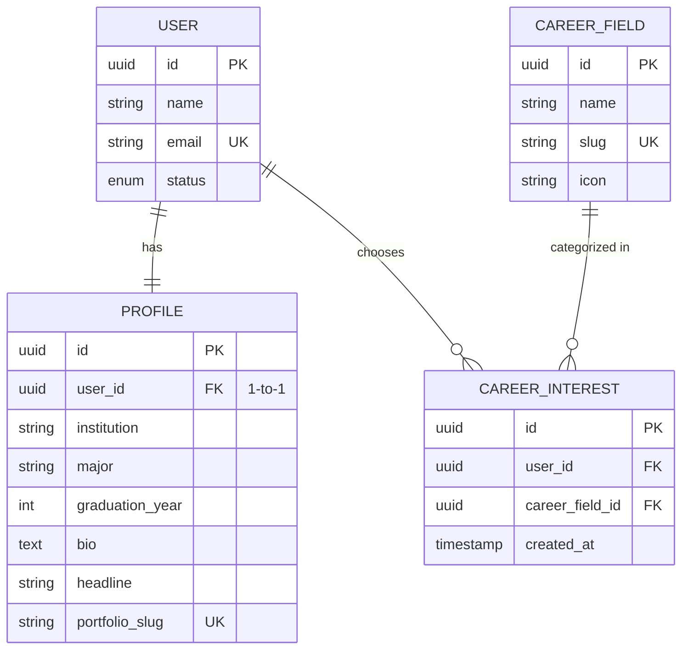

# 🚀 Feature: F02 — Onboarding

> **Branch:** `feature/f02-onboarding`  
> **PIC / Assignee:** Anggota A (Beban: 40% — *Foundation & Core AI Loop*)  
> **Prioritas:** P0 (Must Have)  
> **Dependency:** F01 (Authentication) harus sudah di-merge ke `develop`  
> **Target Merge:** `develop` (Merge ke-2)  
> **Dokumen Terkait:** [PRD (F02)](./plan-md/prd.md#f02--onboarding) · [Task Management](./plan-md/task-management.md#f02--onboarding) · [ERD](./plan-md/erd_growvia.md)

---

## 📌 Deskripsi Fitur

Onboarding adalah *first impression* bagi mahasiswa dan fresh graduate setelah verifikasi akun. Pengalaman ini harus terasa ringan, cepat (selesai dalam **< 3 menit**), dan memandu pengguna dalam membangun profil awal serta menentukan preferensi bidang karier sebelum masuk ke Dashboard.

---

## 🎯 Spesifikasi Kebutuhan & Alur Pengguna (PRD)

Alur onboarding menggunakan antarmuka **Stepper 3 Langkah**:

```text
Langkah 1: Basic Profile ➔ Langkah 2: Career Interest ➔ Langkah 3: First Experience Prompt ➔ Masuk Dashboard
      (Wajib diisi)             (Pilih 1–3 / Skip)             (Tambah / Nanti Saja)
```

### F02.1 Step 1 — Basic Profile (Wajib)
- Input data akademik & profil dasar:
  - **Nama Lengkap** (terisi otomatis dari pendaftaran, dapat diedit)
  - **Institusi Pendidikan / Universitas** (contoh: "Universitas Indonesia")
  - **Jurusan / Program Studi** (contoh: "Sistem Informasi")
  - **Tahun Kelulusan / Angkatan** (dropdown angka, e.g. 2024, 2025, 2026, dst.)
- Progress indicator: Step 1 dari 3.
- Validasi input sebelum melangkah ke step berikutnya.

### F02.2 Step 2 — Career Interest (Opsional / Bisa Dilewati)
- Memilih bidang minat karier dari daftar master data `CAREER_FIELD` (contoh: *Product Management, Software Engineering, Data & AI, UI/UX Design, Digital Marketing, Finance & Business*).
- Batasan: **Minimum 1, Maksimum 3 pilihan**.
- Visualisasi card/chips interaktif yang bisa diklik untuk memilih/membatalkan.
- Tombol aksi: **"Lanjutkan"** (aktif bila 1–3 terpilih) dan opsi **"Lewati untuk Sekarang"** (dapat diatur nanti melalui menu Career).

### F02.3 Step 3 — First Experience Prompt (Opsional)
- Menampilkan ajakan ramah: *"Punya pengalaman organisasi, kepanitiaan, magang, atau proyek yang ingin kamu tambahkan sekarang?"*
- Opsi A: **"Ya, Tambah Pengalaman Sekarang"** ➔ Membuka form cepat input pengalaman pertama (terintegrasi dengan F03).
- Opsi B: **"Nanti Saja, Masuk ke Dashboard"** ➔ Menyelesaikan onboarding dan langsung mengarahkan user ke `/dashboard` dengan *empty state* yang interaktif.

---

## 🗄️ Lingkup Backend & Skema Basis Data

### Endpoint API

| Method | Endpoint | Deskripsi | Proteksi Auth |
|---|---|---|---|
| `GET` | `/api/career-fields` | Mengambil daftar bidang karier (seed data) | User Auth |
| `POST` | `/api/onboarding/profile` | Menyimpan profil dasar mahasiswa (Step 1) | User Auth |
| `POST` | `/api/onboarding/interests` | Menyimpan preferensi bidang karier (Step 2) | User Auth |
| `GET` | `/api/onboarding/status` | Cek apakah user telah menyelesaikan onboarding | User Auth |

### Entitas Basis Data (Ownership: Anggota A)



---

## 💻 Lingkup Frontend

### Rute Halaman
- `src/app/(dashboard)/onboarding/page.tsx` atau `src/app/(blank-layout-pages)/onboarding/page.tsx`

### Komponen UI
- `OnboardingStepper.tsx` ➔ Header progress bar & penunjuk tahapan aktif (1-2-3).
- `StepBasicProfile.tsx` ➔ Form identitas universitas, jurusan, kelulusan.
- `StepCareerInterest.tsx` ➔ Grid kartu bidang karier dengan multi-select toggle.
- `StepExperiencePrompt.tsx` ➔ Call to action pilihan tambah pengalaman atau langsung ke dashboard.

---

## ✅ Kriteria Penerimaan (Acceptance Criteria)

- [ ] Onboarding dapat diselesaikan dalam 3 langkah interaktif (< 3 menit).
- [ ] Validasi step 1 mencegah user lanjut jika form profil belum terisi lengkap.
- [ ] Step 2 membatasi pilihan minat karier antara 1 hingga 3 bidang.
- [ ] Tombol lewati (skip) tersedia di step 2 dan step 3.
- [ ] Setelah selesai, flag onboarding user ditandai selesai dan diarahkan ke `/dashboard`.

---

## 🛠️ Panduan Pengembangan

```bash
# 1. Jalankan development server
npm run dev

# 2. Akses halaman onboarding:
# http://localhost:3000/onboarding

# 3. Jalankan pengecekan tipe data & linting
npm run lint
```
