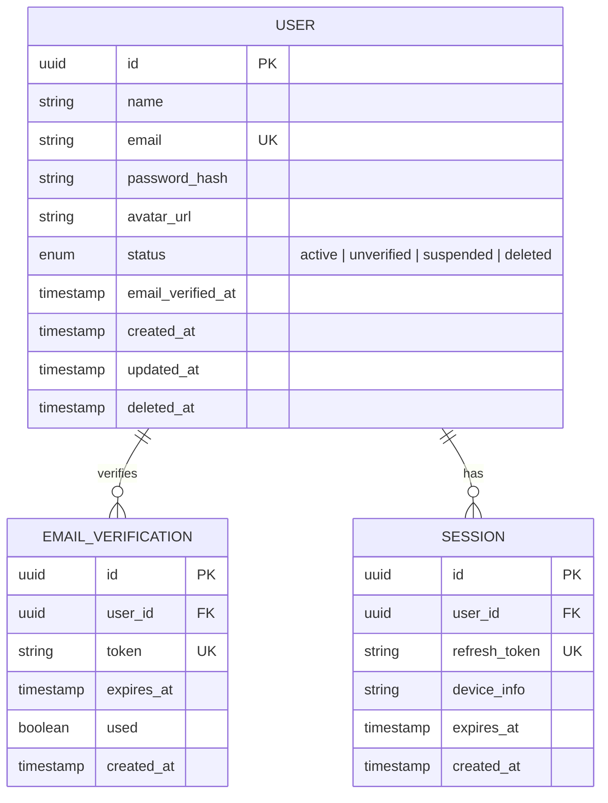

# 🔐 Feature: F01 — Authentication

> **Branch:** `feature/f01-authentication`  
> **PIC / Assignee:** Anggota A (Beban: 40% — *Foundation & Core AI Loop*)  
> **Prioritas:** P0 (Must Have)  
> **Target Merge:** `develop` (Merge ke-1 — *Fondasi Sistem*)  
> **Dokumen Terkait:** [PRD (F01)](./plan-md/prd.md#f01--authentication) · [Task Management](./plan-md/task-management.md#f01--authentication) · [ERD](./plan-md/erd_growvia.md)

---

## 📌 Deskripsi Fitur

Fitur autentikasi dan otorisasi adalah **tulang punggung (foundation)** seluruh sistem Growvia. Menyediakan mekanisme pendaftaran mahasiswa/fresh graduate yang aman, verifikasi email, login bersesi panjang (JWT + refresh token 30 hari), lupa password, dan middleware keamanan (`authMiddleware`) yang akan digunakan oleh seluruh branch fitur lainnya.

---

## 🎯 Spesifikasi Kebutuhan & Sub-Fitur (PRD)

### F01.1 Register
- Form input:
  - **Nama Lengkap**
  - **Email** (format email valid)
  - **Password** (min. 8 karakter, minimal 1 huruf besar, minimal 1 angka)
  - **Konfirmasi Password**
- Validasi *real-time* per field dengan pesan error interaktif.
- Enkripsi password menggunakan `bcrypt` (salt rounds ≥ 10).
- Setelah submit sukses:
  - Simpan akun dengan status `unverified`.
  - Generate token verifikasi dan kirim email verifikasi.
  - Tampilkan state loading saat submit, dan error feedback jika email sudah terdaftar.

### F01.2 Email Verification
- Token verifikasi acak yang aman dan valid selama **24 jam**.
- Batas resend email: cooldown **60 detik**.
- Setelah verifikasi berhasil: ubah status user menjadi `active`, simpan timestamp `email_verified_at`, dan redirect otomatis ke halaman Login dengan notifikasi sukses.

### F01.3 Login & Session
- Form input: **Email** + **Password**.
- Responsif terhadap *rate limiting* untuk mencegah brute-force.
- Pesan error generik demi keamanan: *"Email atau password salah"* (tanpa membocorkan apakah email terdaftar).
- User tidak dapat login bila email belum diverifikasi (status `unverified`).
- Penyimpanan session dengan JWT token & refresh token (stay logged in 30 hari).
- **Logika Redireksi Pasca Login**:
  - Jika profil belum lengkap (`PROFILE` belum ada / belum onboarding) ➔ redirect ke `/onboarding`.
  - Jika profil sudah lengkap ➔ redirect ke `/dashboard`.

### F01.4 Forgot & Reset Password
- Request link reset password melalui email.
- Token reset password dengan masa berlaku terbatas (1 jam).
- Form set password baru dengan validasi keamanan identik dengan registrasi.

---

## 🗄️ Lingkup Backend & Skema Basis Data

### Endpoint API

| Method | Endpoint | Deskripsi | Proteksi Auth |
|---|---|---|---|
| `POST` | `/api/auth/register` | Mendaftarkan akun baru & kirim token email | Publik |
| `POST` | `/api/auth/verify-email` | Memvalidasi token verifikasi email | Publik |
| `POST` | `/api/auth/resend-verification` | Kirim ulang token verifikasi (cooldown 60s) | Publik |
| `POST` | `/api/auth/login` | Login user, issue JWT access & refresh token | Publik |
| `POST` | `/api/auth/logout` | Menghapus token session aktif | User Auth |
| `POST` | `/api/auth/forgot-password` | Kirim email instruksi reset password | Publik |
| `POST` | `/api/auth/reset-password` | Validasi token & update password baru | Publik |
| `GET` | `/api/auth/me` | Ambil data identitas sesi login aktif | User Auth |

### Middleware Bersama (`authMiddleware`)
> ⚠️ **Sangat Penting:** `authMiddleware` harus diuji secara menyeluruh dan di-merge ke `develop` terlebih dahulu agar anggota lain (B dan C) dapat memanfaatkannya di branch masing-masing.

- Memeriksa header `Authorization: Bearer <token>` atau HTTP-only cookie session.
- Mengurai user payload (`userId`, `email`, `role = user`).
- Menghentikan request dengan status `401 Unauthorized` jika token tidak valid/kadaluarsa.

### Entitas Basis Data (Ownership: Anggota A)



---

## 💻 Lingkup Frontend

### Rute & Halaman
- `src/app/(blank-layout-pages)/login/page.tsx` ➔ Halaman masuk.
- `src/app/(blank-layout-pages)/register/page.tsx` ➔ Halaman pendaftaran.
- `src/app/(blank-layout-pages)/verify-email/page.tsx` ➔ Halaman status verifikasi email.
- `src/app/(blank-layout-pages)/forgot-password/page.tsx` ➔ Halaman permohonan reset password.
- `src/app/(blank-layout-pages)/reset-password/page.tsx` ➔ Halaman input password baru.

### Komponen & State Management
- `src/contexts/AuthContext.tsx` ➔ React Context penyimpan session user, token, fungsi `login()`, `logout()`, dan status `isAuthenticated`.
- `LoginForm.tsx`, `RegisterForm.tsx`, `ForgotPasswordForm.tsx`.
- Feedback UI: Alert banner MUI, loading spinner tombol saat submit, input password dengan toggle visibilitas intip password.

---

## ✅ Kriteria Penerimaan (Acceptance Criteria)

- [ ] User tidak bisa login tanpa verifikasi email aktif.
- [ ] Validasi form menampilkan error real-time yang jelas dan aman.
- [ ] Session login tersimpan (stay logged in) hingga 30 hari via refresh token.
- [ ] Redireksi dinamis tepat: belum onboarding ➔ `/onboarding`, sudah onboarding ➔ `/dashboard`.
- [ ] Rate limiting aktif pada endpoint autentikasi.
- [ ] `authMiddleware` berfungsi dengan baik dan siap dipakai oleh branch lain setelah merge ke `develop`.

---

## 🛠️ Panduan Pengembangan

```bash
# 1. Jalankan development server
npm run dev

# 2. Uji endpoint auth & tampilan di:
# http://localhost:3000/login
# http://localhost:3000/register
# http://localhost:3000/forgot-password

# 3. Lakukan linting sebelum submit PR
npm run lint
```
