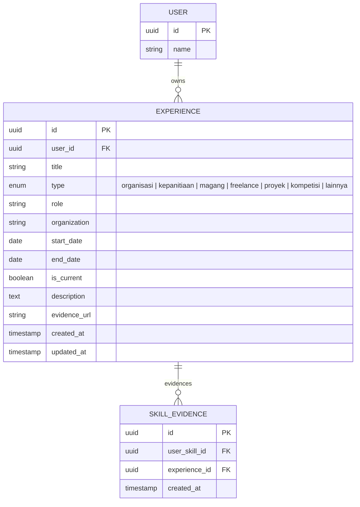

# 💼 Feature: F03 — Experience Management

> **Branch:** `feature/f03-experience`  
> **PIC / Assignee:** Anggota A (Beban: 40% — *Foundation & Core AI Loop*)  
> **Prioritas:** P0 (Must Have)  
> **Dependency:** F01 (Authentication) selesai  
> **Target Merge:** `develop` (Merge ke-3 — *Sumber Data Utama Ekosistem*)  
> **Dokumen Terkait:** [PRD (F03)](./plan-md/prd.md#f03--experience-management) · [Task Management](./plan-md/task-management.md#f03--experience-management) · [ERD](./plan-md/erd_growvia.md)

---

## 📌 Deskripsi Fitur

Pengalaman (*Experience*) adalah **sumber data primer** di Growvia. Pengguna dapat menginput, memperbarui, dan mengelola rekam jejak aktivitas mereka (organisasi kampus, kepanitiaan, magang industri, proyek independen, freelance, dan kompetisi). Data pengalaman dan deskripsi naratif di fitur ini adalah fondasi yang akan diproses oleh mesin AI di F04 untuk mengekstrak kompetensi/skill.

---

## 🎯 Spesifikasi Kebutuhan & Sub-Fitur (PRD)

### F03.1 Experience Form (Input & Edit)
Formulir komprehensif dengan validasi:
- **Field Wajib**:
  - **Judul Pengalaman** (contoh: *"Ketua Divisi Acara Bincang Karir 2026"*).
  - **Tipe Pengalaman** (*Dropdown*: `Organisasi` | `Kepanitiaan` | `Magang` | `Freelance` | `Proyek` | `Kompetisi` | `Lainnya`).
  - **Peran / Posisi** (contoh: *"Lead Frontend Developer"*).
  - **Rentang Waktu**: Tanggal Mulai dan Tanggal Selesai (atau centang *"Masih Berlangsung / Present"*).
  - **Deskripsi Naratif Aktivitas**: Minimal **50 karakter**, maksimal **1000 karakter**. Bagian ini memuat aksi, tanggung jawab, dan hasil kerja yang akan dianalisis oleh AI.
- **Field Opsional**:
  - Nama Institusi / Perusahaan / Organisasi.
  - Link Bukti / Evidence URL (sertifikat digital, link GitHub, Google Drive dokumentasi).
- **Trigger Pasca-Simpan**:
  - Setelah pengalaman berhasil disimpan, sistem otomatis menginisiasi panggilan ke modul F04 (*AI Skill Extraction*).

### F03.2 Experience List (Inbox Tampilan Pengalaman)
- Ditampilkan dalam format **Card List**, terurut kronologis (pengalaman paling baru di atas).
- Menampilkan tag tipe pengalaman, nama organisasi, periode, ringkasan deskripsi, dan badge status skill terkait.
- Fitur pencarian (*Search*) berdasarkan judul / peran / organisasi.
- Filter berdasarkan tipe pengalaman (`Semua`, `Organisasi`, `Magang`, `Proyek`, dst.).
- Tindakan cepat (*Quick Actions*): Edit, Hapus, dan Lihat Detail Lengkap.

### F03.3 Hapus Pengalaman (Delete Experience)
- Konfirmasi dialog interaktif sebelum eksekusi penghapusan.
- **Peringatan Dampak Relasi**: Jika pengalaman tersebut telah terhubung dengan bukti skill di profil (`SKILL_EVIDENCE`), tampilkan pesan peringatan bahwa menghapus pengalaman ini akan mempengaruhi validitas bukti skill terkait.

---

## 🗄️ Lingkup Backend & Skema Basis Data

### Endpoint API

| Method | Endpoint | Deskripsi | Proteksi Auth |
|---|---|---|---|
| `GET` | `/api/experiences` | Mengambil seluruh daftar pengalaman user (filter & pagination) | User Auth |
| `POST` | `/api/experiences` | Menambahkan pengalaman baru & trigger pipeline AI | User Auth |
| `GET` | `/api/experiences/:id` | Mengambil detail satu pengalaman berdasarkan ID | User Auth |
| `PUT` | `/api/experiences/:id` | Memperbarui data pengalaman yang sudah ada | User Auth |
| `DELETE` | `/api/experiences/:id` | Menghapus pengalaman beserta relasi bukti | User Auth |

### Entitas Basis Data (Ownership: Anggota A)



---

## 💻 Lingkup Frontend

### Rute Halaman
- `src/app/(dashboard)/experience/page.tsx` ➔ Halaman daftar seluruh pengalaman.
- `src/app/(dashboard)/experience/new/page.tsx` ➔ Halaman form tambah pengalaman.
- `src/app/(dashboard)/experience/[id]/edit/page.tsx` ➔ Halaman edit pengalaman.

### Komponen UI
- `ExperienceCard.tsx` ➔ Komponen kartu pengalaman individual dengan badge tipe & aksi.
- `ExperienceForm.tsx` ➔ Form lengkap dengan penghitung karakter deskripsi (50–1000 char).
- `ExperienceFilter.tsx` ➔ Filter chip / dropdown tipe dan input bar pencarian.
- `DeleteExperienceModal.tsx` ➔ Dialog konfirmasi modal peringatan hapus.

---

## ✅ Kriteria Penerimaan (Acceptance Criteria)

- [ ] Pengguna dapat membuat, melihat, memperbarui, dan menghapus pengalaman kerja/organisasi.
- [ ] Validasi form aktif: deskripsi wajib minimal 50 karakter agar layak dianalisis AI.
- [ ] Tanggal selesai otomatis dinonaktifkan jika opsi "Masih Berlangsung" dicentang.
- [ ] Dialog konfirmasi muncul sebelum menghapus data dan menampilkan peringatan keterkaitan skill evidence.
- [ ] Setelah pengalaman disimpan, sistem siap memicu event ekstraksi AI ke branch F04.

---

## 🛠️ Panduan Pengembangan

```bash
# 1. Jalankan development server
npm run dev

# 2. Buka halaman pengalaman:
# http://localhost:3000/experience
# http://localhost:3000/experience/new

# 3. Jalankan audit kode
npm run lint
```
