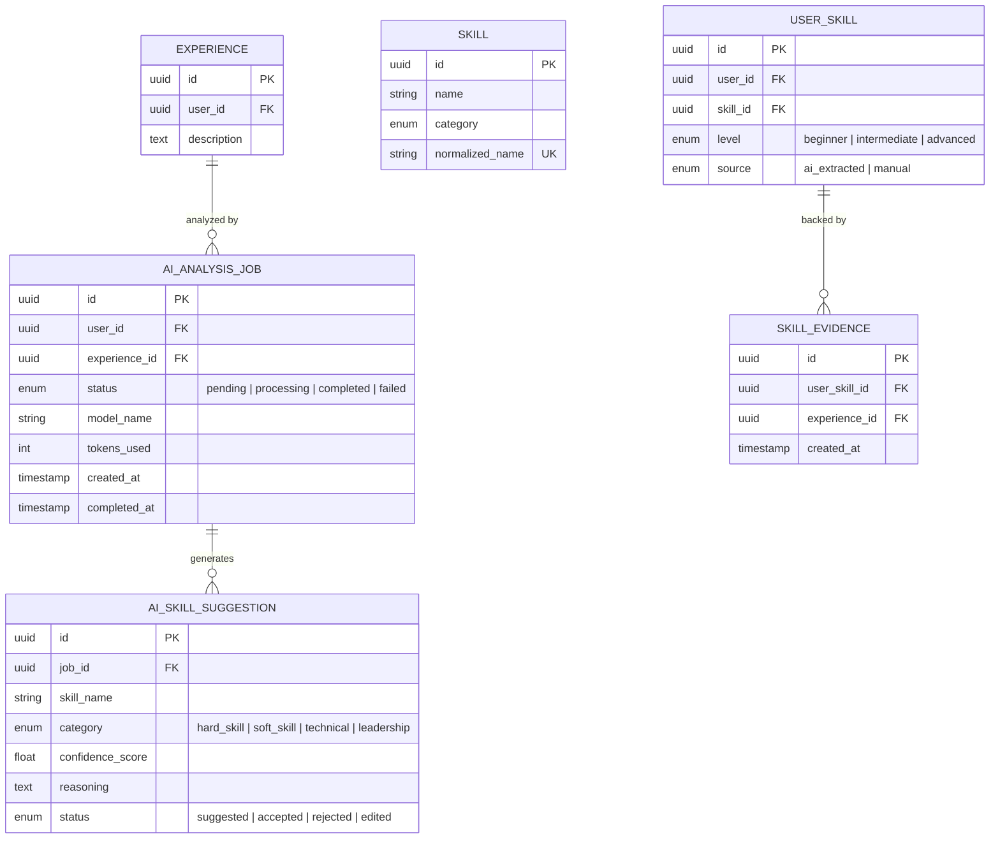

# 🧠 Feature: F04 — AI Skill Extraction

> **Branch:** `feature/f04-ai-skill-extraction`  
> **PIC / Assignee:** Anggota A (Beban: 40% — *Foundation & Core AI Loop*)  
> **Prioritas:** P0 (Must Have — *Core AI Value Proposition*)  
> **Dependency:** F03 (Experience Management) harus sudah di-merge ke `develop`  
> **Target Merge:** `develop` (Merge ke-4 — *Menghubungkan Pengalaman ke Skill*)  
> **Dokumen Terkait:** [PRD (F04)](./plan-md/prd.md#f04--ai-skill-extraction) · [Task Management](./plan-md/task-management.md#f04--ai-skill-extraction) · [ERD](./plan-md/erd_growvia.md)

---

## 📌 Deskripsi Fitur

AI Skill Extraction adalah **fitur inti kecerdasan buatan** di Growvia. Ketika mahasiswa selesai menulis deskripsi aktivitas pengalaman (organisasi, kepanitiaan, magang, proyek), modul ini secara otomatis menganalisis teks, mengekstrak keahlian laten, menormalisasi terminologi sesuai taksonomi standar, memberikan skor keyakinan (*confidence score*), serta menyajikan antarmuka *review* interaktif yang memberi kendali penuh kepada pengguna (manusia tetap sebagai penentu akhir).

---

## 🎯 Spesifikasi Kebutuhan & Pipeline AI (PRD)

```text
Input: Deskripsi Pengalaman (min. 50 char)
   │
   ▼
[ 1. Extract ]     ➔ AI mengekstraksi kata kunci kompetensi dari narasi aktivitas
   │
   ▼
[ 2. Normalize ]   ➔ Standardisasi istilah ke master taxonomy SKILL (misal: "ngomong di depan umum" ➔ "Public Speaking")
   │
   ▼
[ 3. Classify ]    ➔ Kategorisasi 4 domain: Hard Skill | Soft Skill | Technical | Leadership
   │
   ▼
[ 4. Score ]       ➔ Menghitung relevansi konteks & confidence score (0–100%)
   │
   ▼
Output: Antarmuka Review Interaktif (Accept All / Edit / Reject)
   │
   ▼
Simpan ke USER_SKILL & tautkan sebagai SKILL_EVIDENCE
```

### F04.1 Pipeline Ekstraksi AI
- Integrasi ke LLM API (**Gemini 1.5 Flash / Groq Llama 3**):
  - Mengirim prompt terstruktur dengan instruksi ekstraksi ketat (JSON output).
  - Waktu respons ekstraksi harus selesai dalam **< 10 detik**.
  - Menghasilkan **minimal 3 saran skill** untuk deskripsi yang memenuhi syarat (≥ 50 karakter).
- Pencatatan log transaksi AI ke tabel `AI_ANALYSIS_JOB` (model yang digunakan, token, status pengerjaan).

### F04.2 Antarmuka Review Pengguna (Review Interface)
- Ditampilkan dalam format dialog modal interaktif (`AISkillReviewModal`):
  - Setiap skill ditampilkan sebagai kartu/chip saran (*Suggestion Chip*).
  - Dilengkapi badge kategori warna (`Hard Skill`, `Soft Skill`, `Technical`, `Leadership`).
  - Dilengkapi teks alasan singkat AI (*Reasoning*): mengapa skill ini diekstraksi dari deskripsi.
- Opsi interaksi pengguna:
  - **Terima Semua (Accept All)**.
  - **Edit Nama Skill**: Pengguna dapat mengubah nama atau level sebelum disimpan.
  - **Tolak (Reject)**: Menolak saran skill yang tidak relevan.
- Setelah konfirmasi review:
  - Skill yang diterima otomatis tersimpan ke tabel `USER_SKILL` dengan atribut `source = 'ai_extracted'`.
  - Terbuat relasi bukti di `SKILL_EVIDENCE` yang merujuk ke ID pengalaman asal.

### F04.3 Ambang Batas Keyakinan AI (Confidence Score)
- **High Confidence (> 75%)**: Ditandai warna hijau dan otomatis dicentang untuk disetujui (*auto-suggest accept*).
- **Medium Confidence (40% – 75%)**: Ditandai warna kuning netral.
- **Low Confidence (< 40%)**: Ditampilkan terpisah di bagian bawah dengan label peringatan *"Perlu Konfirmasi"* agar pengguna memeriksa ulang secara teliti.

---

## 🗄️ Lingkup Backend & Skema Basis Data

### Endpoint API

| Method | Endpoint | Deskripsi | Proteksi Auth |
|---|---|---|---|
| `POST` | `/api/ai/analyze-experience` | Memicu job ekstraksi AI untuk ID pengalaman tertentu | User Auth |
| `GET` | `/api/ai/suggestions/:job_id` | Mengambil daftar saran skill yang dihasilkan oleh job | User Auth |
| `POST` | `/api/ai/suggestions/:job_id/review` | Menyimpan keputusan review user (bulk accept, edit, reject) | User Auth |

### Entitas Basis Data (Ownership: Anggota A)



---

## 💻 Lingkup Frontend

### Komponen UI
- `AISkillReviewModal.tsx` ➔ Dialog penampil hasil ekstraksi AI.
- `SkillSuggestionChip.tsx` ➔ Chip interaktif dengan tombol accept/edit/reject dan badge confidence.
- `ExtractionLoadingSkeleton.tsx` ➔ Indikator animasi loading saat LLM memproses teks narasi.
- `AIBadge.tsx` ➔ Badge penanda visual untuk skill yang diperoleh dari hasil ekstraksi AI.

---

## ✅ Kriteria Penerimaan (Acceptance Criteria)

- [ ] AI menghasilkan minimal 3 saran skill jika deskripsi pengalaman ≥ 50 karakter.
- [ ] Durasi analisis LLM hingga hasil tampil di layar < 10 detik.
- [ ] Pengguna memiliki kendali penuh untuk menerima, mengedit, atau menolak setiap saran AI.
- [ ] Skill yang disetujui otomatis masuk ke `USER_SKILL` dan terhubung ke `EXPERIENCE` via `SKILL_EVIDENCE`.
- [ ] Saran dengan confidence score < 40% dikelompokkan dengan label "Perlu konfirmasi".

---

## 🛠️ Panduan Pengembangan

```bash
# 1. Konfigurasi API Key LLM pada .env.local
# GROQ_API_KEY=gsk_... atau GEMINI_API_KEY=AIza...

# 2. Jalankan server dev
npm run dev

# 3. Uji integrasi AI dengan submit pengalaman baru di:
# http://localhost:3000/experience/new
```
