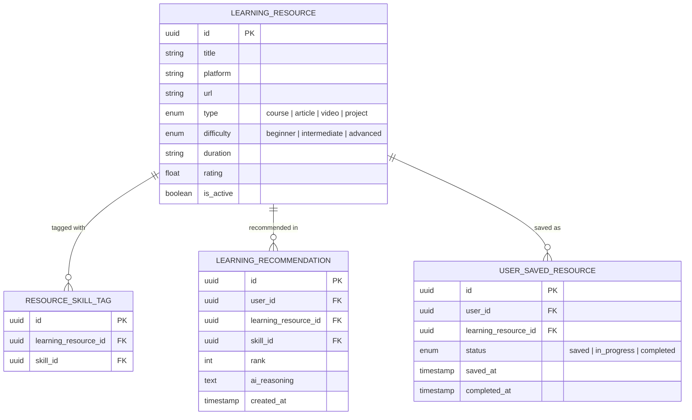

# 📚 Feature: F07 — Learning Recommendation

> **Branch:** `feature/f07-learning`  
> **PIC / Assignee:** Anggota B (Beban: 40% — *Intelligence & Career Engine*)  
> **Prioritas:** P1 (Should Have)  
> **Dependency:** F06 (Career Gap Analysis) harus sudah di-merge (`SKILL_GAP_RESULT` dibutuhkan)  
> **Target Merge:** `develop` (Merge ke-7 — *Menutup Kesenjangan Keahlian*)  
> **Dokumen Terkait:** [PRD (F07)](./plan-md/prd.md#f07--learning-recommendation) · [Task Management](./plan-md/task-management.md#f07--learning) · [ERD](./plan-md/erd_growvia.md)

---

## 📌 Deskripsi Fitur

Learning Recommendation menyediakan rekomendasi materi pembelajaran yang dipersonalisasi untuk mahasiswa guna mengakselerasi penutupan kesenjangan keahlian (*skill gap*). Fitur ini mengadopsi **Hybrid Recommendation Pipeline**: backend menyaring modul materi yang relevan dari basis data kurasi, kemudian model AI (LLM) melakukan perangkingan kontekstual dan menyusun narasi alasan rekomendasi (*AI reasoning*).

> ℹ️ **Integritas Sumber Data:** Modul AI tidak menciptakan sumber materi fiktif. AI bertindak murni sebagai mesin perangkingan cerdas (*ranking & reasoning engine*) dari entitas `LEARNING_RESOURCE` terverifikasi yang dikelola admin.

---

## 🎯 Spesifikasi Kebutuhan & Pipeline Hybrid (PRD)

```text
Kesenjangan Skill Pengguna (Missing & Develop dari F06)
                       │
                       ▼
[ Tahap 1: Candidate Retrieval (Backend) ]
Saring kandidat resource dari LEARNING_RESOURCE yang memiliki kesesuaian skill tags
                       │
                       ▼
[ Tahap 2: AI Contextual Ranking (LLM Gemini / Groq) ]
Kirim kandidat + profil user ke AI ➔ Hasilkan urutan rangking & snippet alasan personalisasi
                       │
                       ▼
[ Tahap 3: Penyajian Antarmuka Pengguna ]
Tampilkan kartu materi terurut dengan label alasan: "Direkomendasikan karena..."
```

### F07.1 Hybrid Recommendation Pipeline
1. **Candidate Retrieval (Backend)**: Query mengambil seluruh materi dari `LEARNING_RESOURCE` yang aktif dan berelasi dengan daftar `missing_skills` dan `develop_skills` pengguna.
2. **AI Ranking (LLM)**: LLM mengevaluasi preferensi, latar belakang jurusan, dan tingkat kesulitan untuk menghasilkan urutan prioritas belajar yang logis.
3. **Penyajian**: Menampilkan minimal 3 materi teratas per skill yang perlu ditingkatkan (jika ketersediaan data memenuhi).

### F07.2 Kartu Materi Pembelajaran (Resource Card)
- Metadata materi:
  - **Judul Kursus / Artikel / Video**.
  - **Platform Penyedia** (contoh: *Coursera, Dicoding, Udemy, YouTube Edu, edX*).
  - **Tipe Materi** (`Course` | `Artikel` | `Video Tutorial` | `Buku / Dokumentasi`).
  - **Estimasi Durasi Belajar** (contoh: *"4 Jam"* atau *"3 Minggu"*).
  - **Tingkat Kesulitan** (`Beginner` | `Intermediate` | `Advanced`).
  - **Skill Target**: Keahlian spesifik yang akan ditingkatkan.
  - **AI Reasoning Snippet**: Kalimat penjelasan personal (contoh: *"Direkomendasikan karena sangat cocok untuk menutup gap React State Management kamu sebelum melamar Frontend Role"*).
- Tombol Aksi:
  - **"Mulai Belajar"**: Membuka tautan URL eksternal di tab baru.
  - **"Simpan / Bookmark"**: Menyimpan materi ke daftar belajar pribadi.

### F07.3 Penyimpanan & Pelacakan Kemajuan (Save & Track)
- Tab **"Materi Tersimpan"**: Menyimpan modul belajar favorit pengguna.
- Aksi **"Tandai Selesai" (Mark as Completed)**:
  - Ketika pengguna menyelesaikan materi, sistem memperbarui progres keahlian di F05 (*Skill Profile*).

---

## 🗄️ Lingkup Backend & Skema Basis Data

### Endpoint API

| Method | Endpoint | Deskripsi | Proteksi Auth |
|---|---|---|---|
| `GET` | `/api/learning/recommendations` | Mengambil daftar rekomendasi hasil perankingan AI | User Auth |
| `POST` | `/api/learning/recommendations/generate` | Memicu komputasi pipeline rekomendasi hybrid baru | User Auth |
| `POST` | `/api/learning/saved` | Menyimpan modul materi ke koleksi pribadi | User Auth |
| `GET` | `/api/learning/saved` | Mengambil seluruh daftar materi yang disimpan pengguna | User Auth |
| `PUT` | `/api/learning/saved/:id/complete` | Menandai materi selesai & memperbarui progres skill | User Auth |

### Entitas Basis Data (Ownership: Anggota B)



---

## 💻 Lingkup Frontend

### Rute Halaman
- `src/app/(dashboard)/learning/page.tsx` ➔ Halaman rekomendasi materi belajar & saved list.

### Komponen UI
- `LearningRecommendationList.tsx` ➔ Grid daftar kartu materi terkurasi.
- `ResourceCard.tsx` ➔ Kartu materi lengkap dengan badge platform, estimasi durasi, dan kutipan AI reasoning.
- `SavedResourceList.tsx` ➔ Daftar materi tersimpan dengan tombol aksi tandai selesai.
- `ResourceFilterChips.tsx` ➔ Filter cepat berdasarkan tipe materi (Video, Kursus, Artikel).

---

## ✅ Kriteria Penerimaan (Acceptance Criteria)

- [ ] Pipeline hybrid sukses menyaring materi dari database dan merankingnya via LLM.
- [ ] Reasoning AI informatif dan ditampilkan jelas pada masing-masing kartu rekomendasi.
- [ ] Pengguna dapat menyimpan materi ke daftar bookmark pribadi.
- [ ] Menandai materi selesai secara otomatis memicu pembaruan kemajuan skill terkait.
- [ ] Penanganan graceful jika kandidat materi < 3 (menampilkan materi yang tersedia tanpa error).

---

## 🛠️ Panduan Pengembangan

```bash
# 1. Pastikan API key LLM terkonfigurasi di .env.local
# 2. Jalankan development server
npm run dev

# 3. Kunjungi modul pembelajaran:
# http://localhost:3000/learning

# 4. Jalankan validasi linting
npm run lint
```
