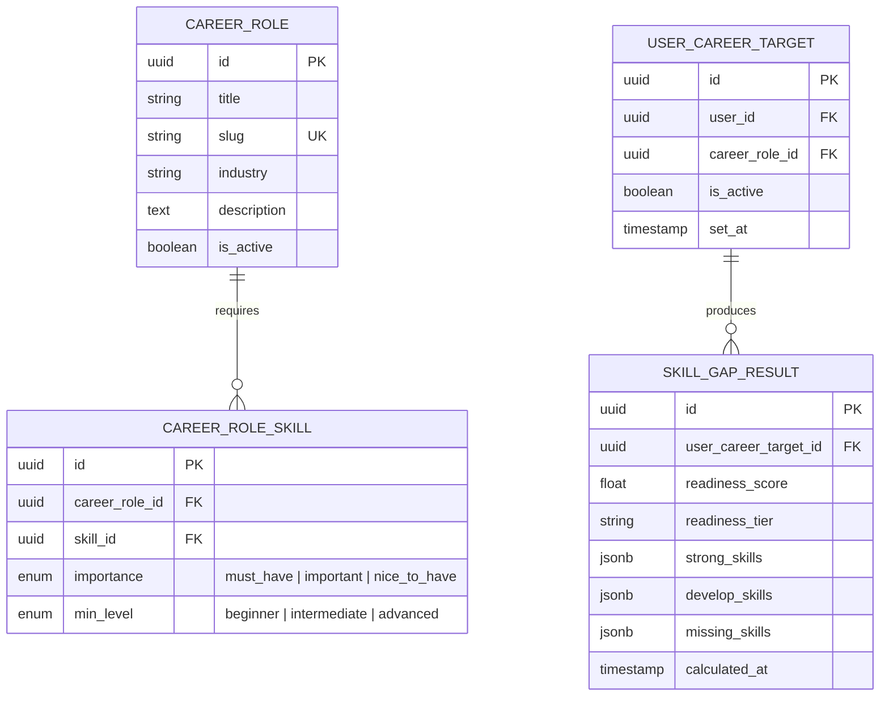

# 🎯 Feature: F06 — Career Target & Skill Gap Analysis

> **Branch:** `feature/f06-career-gap`  
> **PIC / Assignee:** Anggota B (Beban: 40% — *Intelligence & Career Engine*)  
> **Prioritas:** P1 (Should Have)  
> **Dependency:** F05 (Skill Profile) harus sudah di-merge  
> **Target Merge:** `develop` (Merge ke-6 — *Navigasi Arah Karier Mahasiswa*)  
> **Dokumen Terkait:** [PRD (F06)](./plan-md/prd.md#f06--career-target--skill-gap-analysis) · [Task Management](./plan-md/task-management.md#f06--career-target--skill-gap) · [ERD](./plan-md/erd_growvia.md)

---

## 📌 Deskripsi Fitur

Fitur ini membantu mahasiswa dan fresh graduate menentukan tujuan profesi masa depan mereka. Sistem secara komprehensif mengomparasikan profil keahlian yang dimiliki mahasiswa saat ini dengan standar industri peran karier idaman, mengidentifikasi jurang kesenjangan keahlian (*skill gap*), serta mengkalkulasi skor kesiapan karier (*Career Readiness Score*).

---

## 🎯 Spesifikasi Kebutuhan & Logika Analisis (PRD)

### F06.1 Pemilihan Target Karier (Career Target Selection)
- Menjelajahi pustaka peran karier (*Career Role Library*):
  - Daftar peran industri populer: *Product Manager, Frontend Developer, Backend Developer, Data Analyst, UI/UX Designer, DevOps Engineer*, dsb.
  - Fitur pencarian cepat dan filter industri.
- Opsi Custom Target Karier: Jika peran yang dicari belum tersedia di pustaka terdaftar, pengguna dapat memasukkan nama peran karier kustom.
- Pengguna dapat menetapkan, mengganti, atau menonaktifkan target karier aktif kapan saja.

### F06.2 Tinjauan Keahlian yang Dibutuhkan (Required Skills View)
- Setiap peran karier memiliki kurasi keahlian wajib yang dilengkapi atribut tingkat kepentingan (*weight / importance*):
  - `must_have` (Bobot: 3) ➔ Sangat esensial.
  - `important` (Bobot: 2) ➔ Penting.
  - `nice_to_have` (Bobot: 1) ➔ Nilai tambah.
- Menampilkan target minimum level kemahiran (`min_level`: *Beginner / Intermediate / Advanced*).

### F06.3 Analisis Kesenjangan Keahlian (Skill Gap Analysis Board)
Sistem backend membandingkan keahlian pengguna (`USER_SKILL`) dengan keahlian wajib karier target (`CAREER_ROLE_SKILL`) dan mengelompokkannya ke dalam **3 Kolom Status**:
1. **Strong Skills (Keahlian Matang)**: Pengguna sudah memiliki keahlian ini dan tingkat kemahirannya memenuhi atau melebihi `min_level`.
2. **Skills to Develop (Perlu Ditingkatkan)**: Pengguna sudah memiliki keahlian dasar ini, namun tingkat kemahirannya masih berada di bawah `min_level`.
3. **Missing Skills (Belum Dimiliki)**: Pengguna belum memiliki keahlian ini sama sekali dalam profilnya.

### F06.4 Career Readiness Score (Skor Kesiapan Karier)
Formula kalkulasi berbasis bobot di backend:
$$\text{Readiness Score (\%)} = \left( \frac{\sum (\text{Matched Skills} \times \text{Weight})}{\sum (\text{Total Required Skills} \times \text{Weight})} \right) \times 100$$

Tingkatan Skor (*Readiness Tiers*):
- `0% – 39%` : **Starter** (Tahap Awal)
- `40% – 69%` : **Developing** (Sedang Berkembang)
- `70% – 89%` : **Ready** (Siap Melamar)
- `90% – 100%` : **Top Candidate** (Kandidat Unggulan)

---

## 🗄️ Lingkup Backend & Skema Basis Data

### Endpoint API

| Method | Endpoint | Deskripsi | Proteksi Auth |
|---|---|---|---|
| `GET` | `/api/career-roles` | Mengambil seluruh katalog peran karier aktif | User Auth |
| `GET` | `/api/career-roles/:id/skills` | Mengambil daftar keahlian yang dibutuhkan untuk suatu peran | User Auth |
| `POST` | `/api/career-targets` | Menetapkan peran karier target aktif pengguna | User Auth |
| `GET` | `/api/career-targets/active` | Mengambil data peran karier target aktif pengguna saat ini | User Auth |
| `POST` | `/api/career-targets/:id/analyze` | Memicu komputasi analisis gap & readiness score | User Auth |
| `GET` | `/api/skill-gap/:target_id` | Mengambil hasil kalkulasi gap (Strong, Develop, Missing) | User Auth |

### Entitas Basis Data (Ownership: Anggota B)



---

## 💻 Lingkup Frontend

### Rute Halaman
- `src/app/(dashboard)/career/page.tsx` ➔ Halaman utama target karier & analisis kesenjangan skill.

### Komponen UI
- `CareerTargetSelector.tsx` ➔ Dropdown pencarian & kartu pemilihan peran karier impian.
- `ReadinessScoreGauge.tsx` ➔ Gauge / Progress radial penampil persentase kesiapan karier dan lencana tier.
- `SkillGapBoard.tsx` ➔ Tampilan Kanban 3 kolom (Strong, Skills to Develop, Missing Skills) interaktif.
- `CareerRequirementList.tsx` ➔ Rincian bobot kepentingan masing-masing keahlian.

---

## ✅ Kriteria Penerimaan (Acceptance Criteria)

- [ ] Pengguna dapat memilih, mengganti, dan melihat rincian target peran karier mereka.
- [ ] Analisis gap secara akurat membagi keahlian ke dalam Strong, Develop, dan Missing.
- [ ] Perhitungan Career Readiness Score presisi sesuai bobot kepentingan (`must_have`, `important`, `nice_to_have`).
- [ ] Skor kesiapan otomatis terhitung ulang ketika pengguna memperbarui keahlian di F05.

---

## 🛠️ Panduan Pengembangan

```bash
# 1. Jalankan development server
# 1. Jalankan development server
npm run dev

# 2. Buka antarmuka Career Target & Gap:
# http://localhost:3000/career

# 3. Validasi kode dengan lint
npm run lint
```
