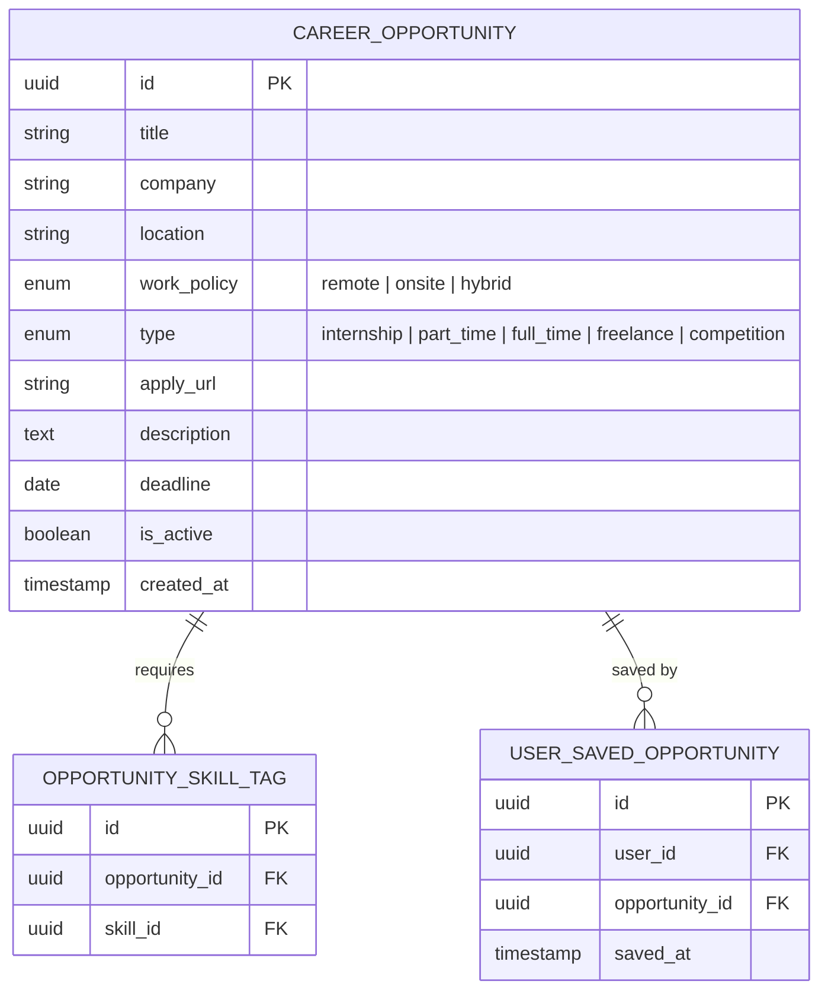

# 💼 Feature: F08 — Career Opportunities

> **Branch:** `feature/f08-opportunities`  
> **PIC / Assignee:** Anggota C (Beban: 20% — *Discovery & Identity*)  
> **Prioritas:** P1 (Should Have)  
> **Dependency:** F01 (Authentication) selesai, dapat dikerjakan paralel dengan F05/F06  
> **Target Merge:** `develop` (Merge Paralel)  
> **Dokumen Terkait:** [PRD (F08)](./plan-md/prd.md#f08--career-opportunities) · [Task Management](./plan-md/task-management.md#f08--career-opportunities) · [ERD](./plan-md/erd_growvia.md)

---

## 📌 Deskripsi Fitur

Career Opportunities adalah etalase eksplorasi peluang karier relevan (magang industri, lowongan kerja paruh waktu, kerja purnawaktu, proyek freelance, dan kompetisi mahasiswa). Sistem backend secara cerdas menghitung persentase kecocokan keahlian (*Skill Match %*) antara kualifikasi yang dibutuhkan lowongan dengan profil keahlian pengguna saat ini, memberikan transparansi instan keahlian apa yang sudah terpenuhi dan apa yang masih kurang.

> ℹ️ **Kalkulasi Deterministik:** Persentase kecocokan skill (*Skill Match*) dihitung langsung oleh logika algoritma backend (bukan LLM), memastikan proses cepat, konsisten, dan akurat.

---

## 🎯 Spesifikasi Kebutuhan & Sub-Fitur (PRD)

### F08.1 Katalog Lowongan (Opportunity List)
- Mengambil data peluang karier terkurasi (dikelola oleh admin via F13):
  - **Tipe Peluang**: `Internship` (Magang), `Part-time`, `Full-time`, `Freelance`, `Kompetisi`.
  - **Lokasi & Kebijakan Kerja**: `Remote`, `On-site`, `Hybrid`, serta nama kota/negara.
  - **Perusahaan & Industri**: Nama institusi/perusahaan perekrut dan logo.
  - **Tenggat Pendaftaran (Deadline)**: Tanggal penutupan dengan indikator hari tersisa.
- Fitur Filter & Pencarian:
  - Pencarian kata kunci (nama posisi / perusahaan).
  - Filter multi-select tipe kesempatan, model kerja (Remote/On-site), dan skill tag yang dibutuhkan.

### F08.2 Kalkulasi Kecocokan Keahlian (Skill Match)
- Setiap kartu lowongan menampilkan persentase kecocokan:
  $$\text{Match \%} = \left( \frac{\text{Jumlah Skill User yang Cocok}}{\text{Total Required Skill Tag Lowongan}} \right) \times 100$$
- Visualisasi Keahlian:
  - **Skill Tag Hijau (Matched)**: Keahlian yang sudah terverifikasi ada di `USER_SKILL` pengguna.
  - **Skill Tag Abu-abu / Merah (Missing)**: Keahlian kualifikasi yang belum dimiliki pengguna.

### F08.3 Simpan & Lamaran Eksternal (Apply & Save)
- **Tombol "Lamar Sekarang" (Apply)**: Mengarahkan pengguna langsung ke situs/portal karier resmi perusahaan perekrut (Growvia v1 tidak menyediakan sistem pelamaran internal langsung).
- **Tombol Bookmark / Simpan (Save Opportunity)**: Menyimpan peluang ke daftar simpanan pribadi pengguna untuk ditinjau kemudian hari.

---

## 🗄️ Lingkup Backend & Skema Basis Data

### Endpoint API

| Method | Endpoint | Deskripsi | Proteksi Auth |
|---|---|---|---|
| `GET` | `/api/opportunities` | Mengambil daftar lowongan dengan filter tipe, lokasi, query, dan kalkulasi match | User Auth |
| `GET` | `/api/opportunities/:id` | Mengambil detail lengkap lowongan beserta breakdown skill match per pengguna | User Auth |
| `POST` | `/api/opportunities/saved` | Menyimpan lowongan ke daftar bookmark user | User Auth |
| `DELETE` | `/api/opportunities/saved/:id` | Menghapus lowongan dari daftar bookmark user | User Auth |

### Entitas Basis Data (Ownership: Anggota C)



---

## 💻 Lingkup Frontend

### Rute Halaman
- `src/app/(dashboard)/opportunities/page.tsx` ➔ Halaman katalog lowongan kerja & magang.
- `src/app/(dashboard)/opportunities/[id]/page.tsx` ➔ Halaman detail lowongan.

### Komponen UI
- `OpportunityCard.tsx` ➔ Kartu lowongan dengan lencana Skill Match %, deadline, dan tag skill.
- `SkillMatchBadge.tsx` ➔ Badge indikator persentase kecocokan (e.g., *85% Cocok*).
- `OpportunityFilterSidebar.tsx` ➔ Panel filter tipe lowongan, lokasi, dan industri.
- `SavedOpportunityDrawer.tsx` ➔ Drawer penampil daftar lowongan tersimpan.

---

## ✅ Kriteria Penerimaan (Acceptance Criteria)

- [ ] Katalog lowongan dapat difilter secara akurat berdasarkan tipe, lokasi, dan skill.
- [ ] Skor Skill Match % terhitung tepat berdasarkan data keahlian pengguna yang sedang aktif.
- [ ] Tag skill dengan jelas membedakan skill yang sudah dimiliki vs skill yang belum dikuasai.
- [ ] Tombol simpan (save/unsave) berfungsi mulus dengan pembaruan status instan.
- [ ] Tombol lamar mengarahkan ke link eksternal di tab baru.

---

## 🛠️ Panduan Pengembangan

```bash
# 1. Jalankan development server
npm run dev

# 2. Buka etalase peluang karier:
# http://localhost:3000/opportunities

# 3. Lakukan audit kode
npm run lint
```
